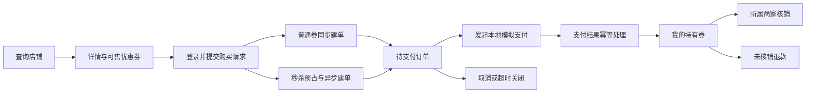

# 邻享生活：系统业务闭环调研与实施方案

调研日期：2026-11-25。本文是实现前的调查和建议，不是新增功能的完成报告。

用户已确定支付范围为**本地模拟支付闭环**，包括支付流水、退款、发券和核销。实际扣款、真实短信、商家结算不属于本次已确定的实现范围。

## 1. 结论与调查范围

目前系统具备店铺浏览、优惠券展示和一部分订单与互动接口，但还没有完整的“购买后得到一张可消费的券”的业务闭环。主要问题来自三类情况：

1. 代码和独立测试已有，但开发库未迁移，因此未启用：普通券多次购买、订单支付/取消/超时关闭、持久事件与缓存补偿。
2. 后端有接口，页面未接入或一致性尚不完整：发帖、关注、关注动态、签到、图片上传、附近店铺。
3. 尚缺真正的业务实现：支付流水、支付结果通知、支付后发券、我的持有券、退款、核销、商家权限、收藏持久化、评论及预约的统一业务入口。

本轮查看了主后端、静态前端、独立 `consultant/` 工程、迁移脚本、已有验收文档，并对开发环境做只读调查。PDF 共 389 页，已建立全文索引，重点核对业务、订单、缓存、限流、互动、GEO、签到与 AI 章节，并渲染检查相关页面。没有执行开发库迁移、业务写接口、后端重启或新一轮压测，也没有提交或 Push。

本文标记含义：

| 标记 | 含义 |
| --- | --- |
| 当前实测 | 本轮访问了运行中的只读接口或检查了实际数据库/Redis/Kafka |
| 代码已有 | 在当前源码中存在；不代表本轮完整运行验证 |
| 独立环境已验证 | 有此前独立环境的验收记录；不代表开发环境已经启用 |
| 拟新增/拟修改 | 实施建议，接口、表和行为尚未实现 |

## 2. 参考资料如何使用

参考文件：`C:/Users/Admin/Desktop/项目/邻享生活/面试-黑马点评.pdf`。下述页码为 PDF 阅读器的 1 起始页码。

| PDF 页码 | 可采用的思路 | 本项目的处理建议 |
| --- | --- | --- |
| 4–7 | 秒杀、缓存、订单边界、限流、AI 的整体范围 | 分模块补业务闭环，再做性能优化 |
| 17–25 | Redis Lua 预扣、限购、Kafka 异步落库、消息对账 | 保留现有预占与 outbox；统一幂等落库和恢复入口 |
| 22–23 | 支付通知可能早于异步订单落库 | 一期正常支付以订单已落库为前提；有效通知持久化后幂等处理，异常缺单不能凭回调入参任意建单 |
| 26–39、243–258 | 空值缓存、逻辑过期、多级缓存、提交后删除和补偿 | 修复现有缓存边界，再启用；券的静态信息和动态库存分开 |
| 40–52 | 超时关单、支付/关单 CAS 竞争、关闭后收到支付成功要退款 | 保留订单取消终态；支付与退款流水解释晚到通知，不能复活已释放库存的订单 |
| 54–77 | 注解、AOP、Redis 滑动窗口与多个限流维度 | 接入真实用户身份，修复同毫秒计数，按接口配置阈值 |
| 83–93 | AI 查询商家、商家券、用户券和预约 | 先做有权限的业务 API，再让 AI 调用；用户身份来自登录上下文 |
| 324–350 | 发帖、点赞、关注、共同关注和动态 | 补页面、关系幂等和持久化恢复机制 |
| 351–365 | GEO、签到、连续签到、UV | GEO 需要实际索引与同步；签到补页面；UV 是运营统计 |
| 368–376 | 普通券允许一人多单、秒杀券一人一单，按策略组织 | 普通券请求幂等与秒杀限购分开；不把全局用户/券唯一索引用于普通券 |
| 382 | 订单状态 1–6、支付/核销/退款时间 | 状态字段存在不等于对应功能已完成；增加支付、券实例、退款和核销记录 |

PDF 第 23 页明确说明 Kafka 代码是“参考示例，没有实际运行过”。第 52 页主要描述支付回调和退款思路，并未提供可直接运行的支付闭环。第 372–373 页的普通券示例包含库存与分布式锁，但当前项目普通券没有库存模型；默认普通券不限购买次数、无总量库存，不照搬该锁。收藏、笔记评论、店铺评价等按本项目需求补充，不声称 PDF 已完整设计。资料中的性能数据不能作为本项目实测结果。

## 3. 开发环境当前事实

本轮调查时，开发依赖 MySQL `3306`、Redis `6379`、Kafka `9092` 的三个容器健康运行。后端 `8081` 存在监听，进程创建时间为 2026-11-25 11:43:41（本机时间）。因此“原后端没有重启”的旧说明不能继续当作当前进程事实；但**重启没有完成数据库迁移**。

开发库 `hmdp` 现有 10 张表：用户、用户信息、店铺、店铺分类、券、秒杀券、订单、笔记、笔记评论和关注。聚合数量为：15 家店铺、9 种券、8 笔订单、6 个用户、5 篇笔记；关注和笔记评论记录均为 0。

当前结构与数据：

- `tb_voucher_order` 仍有全局唯一索引 `uk_voucher_order_user_voucher(user_id,voucher_id)`；没有 `request_id`、`seckill_voucher_id`。
- 没有 `tb_reliable_event` 和阶段四的订单状态/创建时间索引，结构不满足生命周期启用检查。
- 8 笔订单全为未支付，其中 6 笔秒杀、2 笔普通；按数据库时钟都已超过 15 分钟。
- 没有支付流水、持有券、退款、核销、商家账号绑定、收藏或预约表。
- `tb_user.phone` **已有唯一索引**；问题是自动注册的并发重复键处理，而不是缺手机号唯一约束。
- `tb_follow` 只有主键，没有用户/被关注用户的联合唯一约束。
- Redis 没有 `shop:geo:*` 索引。券 23–28 的 Redis 与 MySQL 当前可用库存均为 2，每券资格 SET 数为 1；outbox 长度为 0。
- Kafka `seckill-voucher-order` 的消费者组 `your-group-id` 本轮快照为 offset 7/7、lag 0。瞬时 lag 为 0 和库存相等不能替代业务全链路验收。
- 数据库时钟显示 UTC，页面和 Java 需要核对统一的时区/时间序列化规则，避免倒计时和活动时间偏差。

本轮匿名只读接口探针：

| 接口 | 观察结果 |
| --- | --- |
| `GET /` | HTTP 200，前端 HTML 可访问 |
| `GET /shop-type/list` | 返回 10 个分类 |
| `GET /shop/of/name?current=1&size=12` | 返回 12 家，total=15 |
| `GET /shop/18` | 返回店铺详情 |
| `GET /voucher/list/18` | 返回 5 种已展示的券 |
| `GET /shop/of/type?typeId=1&current=1&size=12` | 返回 10 家，total=10 |
| 分类查询加 `x=120.15&y=30.27` | 返回空列表；与 GEO 索引缺失一致 |
| `GET /blog/hot?current=1` | 返回 5 篇笔记 |
| `GET /user/me`、`GET /voucher-order/mine` | 匿名 HTTP 401 |
| `GET /blog/1`、`GET /demo/shop/18/capabilities` | 匿名 HTTP 401 |

证据保存在 `target/system-audit-20261125/`：`http-probes.json`、`development-schema-and-counts.txt`、`redis-inventory.json`、`geo-inventory.json`、`kafka-group-status.txt`。这些是调查快照，不是负载测试报告。

## 4. 功能清单与缺口

### 4.1 用户、浏览与优惠券

| 功能 | 当前情况 | 拟补齐行为 | 主要代码依据 |
| --- | --- | --- | --- |
| 验证码登录 | Redis 验证码、自动注册、Token 已有；验证码只打印日志；成功后未销毁 | 本地验证码方式明确标识；一次性校验；并发注册重复键后读取原用户；验证码/登录限流 | `UserServiceImpl.java:49,68,169` |
| 退出与资料 | `/user/logout` 返回“功能未完成”；前端只清本地 Token；资料只有读取 | 服务端撤销当前 Token；用户只修改自己的公开资料；旧 Token 再访问返回 401 | `UserController.java:60`，`assets/app.js:73` |
| 会话期限 | `LOGIN_USER_TTL=36000`，单位分钟；登录和刷新共用此值 | 配置化统一会话期限；明确滑动续期与退出效果 | `RedisConstants.java:7`，`RefreshTokenInterceptor.java:44` |
| 店铺搜索/分页 | 当前查询实测通过；评分/价格只对当前页在浏览器排序 | 后端支持全局排序及稳定分页，过滤条件切换重置页码 | `ShopController.java:98`，`assets/app.js:149` |
| 附近店铺 | GEO 查询代码有；未指定距离升序；当前没有索引，前端未传位置 | 初始化与更新 GEO；坐标校验；距离升序和稳定翻页；定位拒绝时可继续普通查询 | `ShopServiceImpl.java:93,115`，`HmDianPingApplicationTests.java:70` |
| 店铺详情 | 穿透保护和空值缓存已接入；逻辑过期/互斥分支被注释 | 详情从后端读取；修好冷启动与锁，再按配置启用热点缓存 | `ShopServiceImpl.java:48`，`CacheClient.java:75,120` |
| 店铺收藏 | 浏览器 localStorage，未绑定账号，无后端接口/表 | 登录后持久化收藏、取消、我的收藏；访客收藏单独保留；迁入账号须由用户选择 | `assets/app.js:57,312` |
| 店铺数据管理 | 新增接口直接 save；更新只有演示白名单，无商家所有权 | 管理员授权商家；商家只能维护所属店铺；字段、存在性和图片校验；下架影响展示和新购买 | `MvcConfig.java:26`，`ShopController.java:46,59`，`DemoShopAccess.java:11` |
| 券展示 | 普通与秒杀列表已有且当前可查；默认缓存 mode=mysql | 价格/面额/可售时间/使用有效期分开显示；显示资格和真实可购状态 | `VoucherMapper.xml`，`VoucherListCacheService.java:68`，`application.yaml:70` |
| 券创建/上下架 | 创建接口有，缺角色、完整校验和管理页面；秒杀初始化 Redis 失败无持久补偿 | 券草稿→活动准备→可售→下架；初始化成功后才可售；失败重试和人工查询；价格变更只影响新单 | `VoucherController.java:30,41`，`VoucherServiceImpl.java:50` |
| 普通券购买 | 请求幂等、重复购买代码及独立验证已有；开发 phase5 未迁移 | 每个新购买请求生成一笔单；同请求重试同单；默认不限制总购买次数和库存 | `VoucherOrderServiceImpl.java:124`，`VoucherOrderMapper.java:17` |
| 秒杀购买 | Lua 预扣+资格 SET+reservation/outbox+Kafka+事务落库；独立验收已有 | 保留链路，补不可售活动保护、排队恢复、限流和业务状态提示 | `seckill.lua`，`SeckillOrderPublisher.java`，`SeckillVoucherConsumer.java` |

### 4.2 交易、支付与消费

| 功能 | 当前情况 | 拟补齐行为 | 主要代码依据 |
| --- | --- | --- | --- |
| 我的订单/详情 | 查询已有；秒杀异步落库前可返回 PENDING；订单 ID 用字符串 | 统一状态、金额快照、剩余时间、可执行操作；我的订单和我的券分开 | `VoucherOrderServiceImpl.java:188,206,248` |
| 订单金额/规则 | 查询时从当前券读取标题、价格、类型；订单没有快照 | 下单冻结金额、面额、店铺、券类型、规则与使用有效期方案；修改券不改变旧单 | `VoucherOrderServiceImpl.java:259`，`VoucherOrder.java` |
| 模拟支付 | CAS 把未支付改为已支付，写 pay_type=0；没有支付单或发券 | 支付单→模拟结果→通知处理→已支付+发券；金额由服务端决定；可查询流水 | `OrderLifecycleService.java:26`，`VoucherOrderMapper.java:31` |
| 取消/超时 | CAS、MySQL 返库存、可靠事件和 Redis 幂等恢复已有；开发 phase4 未启用 | 明确新单与历史范围；定时和被动关单用同一判定；返还只执行一次 | `OrderLifecycleService.java:36`，`VoucherOrderMapper.java:36`，`restore-seckill-stock.lua` |
| 库存类型 | 关单按当前是否存在秒杀表决定返库存 | 依订单快照/库存占用记录处理，不能随当前券类型变化 | `OrderLifecycleService.java:41` |
| 用户持有券 | 无券实例，已支付仅是订单状态 | 每笔成功购买对应一张券，记录持有人、来源订单、核销码、有效期、状态 | 数据库结构；`VoucherOrder.java:50` |
| 退款 | status=5/6 与时间字段存在，服务逻辑没有 | 未核销券全额模拟退款；退款单与结果幂等；退款期间冻结核销；退款成功失效券 | `VoucherOrder.java:50,73`；主后端无退款接口 |
| 商家核销 | status=3 与 use_time 存在，没有核销接口或记录 | 所属商家校验券→一次性核销；核销与退款互斥；留操作人、店铺和流水 | `VoucherOrder.java:50,68`；主后端无核销接口 |
| 支付/关单竞争 | 原 CAS 竞争已有独立验证，但只覆盖当前模拟更新状态 | 通知赢则发券；关单赢且支付已成功则发起退款，不再发券、不再次返库存 | `OrderLifecycleService.java`；PDF 50–52 |
| 排队恢复/运维 | outbox 和事件重试已有；持久事件含阻塞状态；UI 仅演示店铺删缓存查询/重投 | 排队订单可查原 ID；永久异常进入人工处理；后台查看支付、退款、库存、缓存事件和处理记录 | `ReliableEventService.java`，`CacheCompensationController.java` |

### 4.3 互动、统计、预约与 AI

| 功能 | 当前情况 | 拟补齐行为 | 主要代码依据 |
| --- | --- | --- | --- |
| 热门笔记/详情 | 热门当前实测通过；详情前端使用列表旧对象；公开详情被要求登录 | 点击详情请求真实数据；匿名浏览公开内容；登录用户得到自己的点赞状态 | `BlogServiceImpl.java:54,70`，`assets/app.js:631`，`MvcConfig.java:30` |
| 点赞/取消 | Redis 判断、DB 计数、Redis 关系分步操作，缺并发幂等与故障恢复 | 改为明确点赞/取消状态；持久关系唯一；计数与关系同事务，Redis 可重建 | `BlogServiceImpl.java:98` |
| 发帖/图片 | 发帖接口有；保存后逐粉丝 Redis 推送，失败无事务补偿；前端没发布入口 | 正文、店铺、图片校验；发布后事件推送；我的笔记和编辑/删除权限；图片完整上传与读取 | `BlogServiceImpl.java:148`，`BlogController.java` |
| 图片存储 | 匿名放行，删除是 GET，目录固定为旧 nginx 路径，未验证归属和目录边界 | 可配置存储目录与 URL；登录上传；文件类型/大小/真实内容校验；仅删自己的文件 | `UploadController.java:20,37`，`SystemConstants.java:4`，`MvcConfig.java:29` |
| 关注/共同关注/动态 | 后端有，前端没入口；关注无联合唯一约束；Redis 关系/收件箱无完整恢复 | 禁自关注，验证对象，关注幂等；持久关系；动态同时间跨页游标修复和冷启动恢复 | `FollowServiceImpl.java:39,77`，`BlogServiceImpl.java:172` |
| 笔记评论 | 有表和模板，Controller 空；无页面 | 评论分页、回复、本人删除/管理员处理；评论数与有效评论一致 | `BlogCommentsController.java`，`BlogCommentsServiceImpl.java` |
| 店铺评分/销量 | 读取店铺数据库字段，无完整评价或统计来源 | 券销量与核销量按真实交易汇总；店铺评价拟按已核销订单限制一次；笔记评论不充当店铺评价 | `Shop.java`、当前主后端 Controller 清单 |
| 签到 | 位图和统计接口有；前端无入口；连续签到只计算本月 | 今日状态、签到日历、连续天数；统一日期时区并支持跨月；不凭空加入积分奖励 | `UserServiceImpl.java:112,128` |
| UV | 仅测试中的 HLL 演示，没有实际埋点和运营接口 | 按日/店铺记录去重访问，说明近似统计；管理端查看，不混作精确交易计数 | `HmDianPingApplicationTests.java:96` |
| 预约 | 主后端无接口/表；consultant 有简单 INSERT/按手机号查询 | 先实现账号所属预约、店铺/时间/营业校验、确认/取消/完成；商家只处理所属店铺预约 | `consultant/src/main/java/com/itheima/consultant/service/ReservationService.java:18`、`ReservationMapper.java:14` |
| AI 顾问 | 单独 Boot 3.5/Java17 工程；主后端 Boot 2.3/Java11，未聚合、未接主页面 | 保持适配服务；工具调用统一业务 API；会话绑定登录用户；准确显示工具执行结果 | `consultant/pom.xml:8,30`、`ChatController.java:15`、`ConsultantService.java:12` |

AI 工程还有两项明确的结构不兼容：`VoucherOrderMapper.java:22` 查询订单的 `phone`，主开发订单表没有此列；`ReservationMapper.java:14` 写 `reservation.shop_name`，开发没有此表，而附带 SQL 中 reservation 是考生信息模板、也没有 shop_name。不能导入该整库 SQL 来修复。现有按输入手机号查询他人券/预约和任意 memoryId 读会话的方式，应改为认证用户上下文与所属会话。

### 4.4 横切问题

- **写权限**：`MvcConfig` 对 `/shop/**`、`/voucher/**`、`/upload/**` 整段放行；店铺新增、券新增和上传源码没有完整角色/归属检查。先建立身份与店铺所有权，不能把“登录了”当作“拥有所有店铺”。
- **错误契约**：`WebExceptionAdvice.java:13` 将 RuntimeException 转为 HTTP 200，并返回异常 message。拟增加稳定业务 code、401/403/404/409/429/5xx 区分；内部异常留在服务日志，页面只显示业务信息和查询编号。
- **限流**：目前只有分类查询使用方法级 5 秒 5 次；全体用户共用。`RateLimiterAspect` 的 USER 返回固定 anonymous；`limiter.lua:41` 同毫秒重新设随机种子可能使 ZADD 覆盖计数。拟接真实用户、唯一请求标识和接口配置；验证码、登录、秒杀分别设阈值，支付结果通知走单独可靠处理策略。
- **缓存**：逻辑过期冷缓存直接返回 null，数据格式与当前穿透缓存不同；互斥重试 finally 可能删除未持有的锁，锁无持有者校验。不能仅取消注释就启用。券列表缓存包含动态库存，写入和秒杀落库没有完整失效链；Caffeine 失效也只影响单进程。
- **接口数据**：保留订单 ID 字符串约定，新增支付/券/退款/核销 ID 一致处理；金额为整数分；统一分页、状态和时间格式。权限和金额判断放后端。
- **测试隔离**：历史 `HmDianPingApplicationTests` 包含写缓存、GEO 初始化和大量 ID/HLL 操作，不能直接在开发数据上跑全量测试。后续业务测试使用带环境守卫的独立库和专有数据。

## 5. 目标业务链路与建议规则

以下均为拟实现的行为；已有规则特别注明。



### 5.1 券商品、订单和持有券分开

券商品描述“可以买什么”；订单记录“谁以什么价格买了什么”；持有券记录“支付成功后，这张券是否还能消费”。订单已创建不表示已支付，已支付不表示已核销。前端的“我的订单”与“我的优惠券”分别呈现交易与消费状态。

建议规则：

- 普通券允许重复购买。新购买请求新订单；相同 `Idempotency-Key` 只返回原结果，相同 key 改换商品应拒绝。已有实现的方向保留。
- 秒杀继续按用户/活动券限一次，Lua 与数据库唯一约束共同保护。当前规则取消后仍不恢复购买资格；返库存不会 SREM 用户。若今后允许取消后重抢，需要单独调整资格和数据库约束，不能顺手改。
- 秒杀响应丢失后的合法重试应能查回原受理编号与进度。拟在 Lua 原子预占时保存用户/活动券到订单编号的映射，避免只返回“重复下单”却无法找到排队中的原单；新的购买意图仍受限购约束。
- 一期每笔订单购买一张券，不增加购物车或多数量结算。成功支付一单发一张券，重复支付通知不会多发。
- 普通券默认无总库存、不限累计购买次数；有库存的特殊普通券将来另设显式规则，不能借秒杀表隐式识别。
- 秒杀活动可购买时间与券的可使用有效期分开。新券应明确绝对有效期或支付后 N 天，以及使用条件；历史券没有配置时不擅自补一个截止日期。
- 所有金额由服务端商品/订单快照计算，整数分存储。面额与购买价分开，退款按支付金额，不按抵扣面额。
- 下架只阻止新购买，不能抹除历史订单和已发券。价格、标题、规则变更不影响既有快照。
- 一期一张券一次核销，不拆分、不找零；叠加、最低消费等需显式配置和明确校验输入，不能仅凭文案假装已校验。

### 5.2 状态与竞争处理

保留现有订单数字状态：1 未支付、2 已支付、3 已核销、4 已取消、5 退款中、6 已退款。取消原因另外记录用户取消/超时。异步的 PENDING 属于建单进度，不冒充已落库的支付状态。

| 事件 | 允许的流转 | 同步必须完成的事实 |
| --- | --- | --- |
| 普通提交/秒杀消费建单 | 创建未支付订单 | 请求/消息幂等，保存快照；秒杀 DB 扣库存与 INSERT 同事务 |
| 支付结果成功 | 未支付→已支付 | 校验已发出的支付单、订单、用户绑定、渠道、金额；确认支付流水；同事务生成唯一券实例 |
| 取消/超时 | 未支付→已取消 | CAS 赢后才提交库存释放记录；秒杀 DB 返库与可靠事件同事务 |
| 发起退款 | 已支付且券未核销→退款中 | 冻结券，创建唯一退款单，禁止同时核销 |
| 退款成功 | 退款中→已退款 | 退款流水、券失效；按库存占用记录决定是否返库，且仅一次 |
| 核销 | 已支付且券可用→已核销 | 所属商家、有效期与使用条件校验；券状态、核销流水、订单同事务 |

支付、关单、退款和核销以数据库条件更新/必要行锁决定胜负；保持锁顺序一致，不能 Redis 判断后直接覆盖状态。

晚到通知：如果订单已经关闭，支付渠道仍返回成功，订单保留已取消；记录支付成功事实并创建退款补偿，不发券、不再次释放库存。退款结果在支付/退款记录中查询。重复通知只返回先前处理结果。

一期正常支付必须等待订单落库。秒杀排队期间页面显示“正在创建订单”，可查询原 ID，不能拉起支付；长时间无结果显示可恢复/需处理状态，不告诉用户支付成功。有效支付结果先持久记录，再处理和重试；找不到合法支付单的通知拒绝，不按传入 orderId/amount 补造订单。若以后开放预占期间支付，必须先扩展可信预占快照与支付单绑定，并复用统一幂等建单入口，此时再实现 PDF 第 22–23 页的完整早到通知场景。

### 5.3 本地模拟支付方式

拟建立支付渠道接口和 MOCK 实现。前端发起支付，后端创建支付单；模拟器提供成功、失败、取消、延迟/重复结果，全部进入同一支付结果处理服务。现有 `/voucher-order/{id}/pay/simulate` 可保留为兼容入口，但内部转调支付单流程。

模拟渠道不扣钱，订单/支付页面明确标识“模拟支付”。支付结果确认不能由前端任意填写用户、金额或成功状态直接修改订单；本地模拟通知使用已发出的模拟支付单及受控凭证，回调入口不依赖浏览器登录，但必须校验来源、绑定与幂等。模拟器仅在显式开发/独立测试配置下开放。

未核销券可申请全额模拟退款；核销后一期拒绝自助退款。退款和核销竞争只有一个成功。建议已支付未核销券退款成功后释放一次秒杀占用；若活动已结束，可记录释放但不重新开放活动。具体可购状态与库存账分开。过期券标记不可核销，退款条件以配置的规则判定，不能自动把所有过期券退款。

### 5.4 库存账与缓存账

库存按唯一占用/释放记录解释，而不是“当前库存+所有历史订单数”。每笔业务最多扣一次、释放一次；支付成功不会再扣一遍秒杀库存；核销不会再返库。

建议对账口径：

```text
MySQL 可用库存 = 初始投放 + 已批准调整 - 已提交的库存占用 + 已提交的库存释放
Redis 可用库存 = 初始投放 + 已镜像调整 - 已接收的有效预占 + 已镜像库存释放
```

两边暂时差额必须能由“预占尚未落库”或“DB 已返还但 Redis 补偿未完成”等具体记录解释。稳态无在途、无阻塞事件时再要求一致。取消、退款和晚到支付退款不能相互重复返还；禁止凭某一次 SELECT/GET 的差额盲目 INCR 修复。

缓存只加速展示，不能决定支付金额、购买资格或核销资格。商品静态信息可使用 Redis+Caffeine；动态可售库存按实际预占账读取并标明可用量，商家端另看 DB/在途/补偿情况。所有实例的本地缓存失效应广播或依版本失效，不能用同组 Kafka 只送一个实例就声称广播。写库及持久失效事件同事务，提交后删除，重试与 TTL 兜底；并补并发读回填旧值的版本保护。

## 6. 拟修改的数据模型与接口

### 6.1 数据模型建议（均未落地）

| 模型 | 需要表达的事实与约束 |
| --- | --- |
| 订单扩展 | 类型、店铺、标题/规则/金额快照，支付截止时间，取消原因，生命周期管理标记；沿用 phase5 请求/秒杀唯一约束 |
| 支付单/支付通知 | 订单及用户绑定、渠道 MOCK、金额分、支付单号、渠道交易号、结果/处理状态、时间；请求和渠道通知唯一；一单只结算一次 |
| 持有券 | 用户、来源订单、所属店铺、券规则快照、有效期、核销码及状态；来源订单唯一，核销码不可由连续订单号直接充当 |
| 退款单 | 原支付、退款金额、业务原因、申请/渠道结果/重试状态；同一次退款请求唯一，累计成功退款不超过实付 |
| 核销记录 | 券实例、店铺、操作人、核销时间、请求编号；每张券成功核销唯一 |
| 库存占用/释放账 | 订单/预占、数量、唯一业务事件、扣减或返还及镜像进度；便于对账和故障恢复 |
| 商家/店铺权限 | 账号角色与店铺绑定，管理员授权记录；不改造普通用户为全局管理员 |
| 收藏/点赞/关注 | 用户关系持久化，联合唯一约束；计数或 Redis 索引可重建 |
| 预约 | user_id、shop_id、联系信息、预约时间/人数、状态、幂等请求；不再凭手机号决定权限 |
| 店铺评价（扩展） | 关联已核销订单、用户、店铺、分数、文字/图片与有效状态；订单评价唯一 |

沿用并扩展现有可靠事件能力处理库存、缓存、动态等跨系统副作用，不再在每个 Controller 自造一套补偿。新增支付结果的持久收件记录解决“通知已收到但处理未完成”的问题。

### 6.2 现有入口与拟新增入口

已有接口保留兼容；下表带“拟新增”的路径只是设计草案，当前不能调用。最终接口文档在实现时同步生成。

| 业务 | 当前入口 | 拟新增/拟调整契约 |
| --- | --- | --- |
| 用户 | `/user/code`、`/user/login`、`/user/me`、`/user/logout`、`/user/info/{id}` | 实现 logout；拟新增 `PATCH /user/me`，不接收可提权字段 |
| 查询店铺 | `/shop/of/name`、`/shop/of/type`、`/shop/{id}`、`/shop-type/list` | 扩展后端 sort/坐标/稳定分页，保留旧请求默认值 |
| 商家商品管理 | `POST/PUT /shop`、`POST /voucher`、`POST /voucher/seckill` | 补角色/归属检查；拟新增 `/merchant/shops` 与 `/merchant/vouchers` 管理入口、上下架和活动准备状态 |
| 购买与订单 | `POST /voucher-order/normal/{id}`、`POST /voucher-order/seckill/{id}`、`GET /voucher-order/{id}`、`GET /voucher-order/mine`、`POST /voucher-order/{id}/cancel` | 统一响应中的建单进度/交易状态/可操作性；继续使用请求幂等 |
| 发起/查询支付 | `POST /voucher-order/{id}/pay/simulate` | 拟新增 `POST /payments`、`GET /payments/{id}`；订单绑定、金额服务端计算、请求幂等 |
| 模拟渠道结果 | 尚无 | 拟新增 `POST /mock-payments/{id}/confirm` 与受控结果通知入口；普通用户仅操作自己的支付单，不能任意修改订单 |
| 我的持有券 | 尚无 | 拟新增 `GET /user-vouchers/mine`、`GET /user-vouchers/{id}`；只看自己的券与核销凭证 |
| 退款 | 尚无 | 拟新增 `POST /voucher-order/{id}/refunds`、`GET /refunds/{id}`；查权限、规则和幂等结果 |
| 商家核销 | 尚无 | 拟新增 `POST /merchant/redemptions`；凭核销码与请求编号，服务端校验所属店铺；查询所属核销记录 |
| 收藏 | 尚无 | 拟新增 `PUT/DELETE /shop/{id}/favorite`、`GET /user/favorites`；明确设置状态，重试幂等 |
| 笔记互动 | `/blog`、`/blog/hot`、`/blog/{id}`、`/blog/like/{id}`、`/blog/of/me`、`/blog/of/user`、`/blog/of/follow`、`/follow/*` | 发布、详情、用户主页与关注动态接页面；点赞改明确状态入口，旧 toggle 接口兼容处理 |
| 笔记评论 | `/blog-comments` Controller 模板，没有 handler | 拟新增笔记评论列表、发表评论/回复和删除本人评论入口 |
| 签到 | `POST /user/sign`、`GET /user/sign/count` | 拟新增月份签到状态查询，补用户中心页面 |
| 预约 | consultant 内部工具，无主业务接口 | 拟新增 `POST /reservations`、`GET /reservations/mine`、取消入口与商家确认/完成入口 |
| AI | 独立 consultant 的 `/chat` | 拟建立认证接入与用户所属会话；工具调用上述业务 API；预约操作先呈现内容供用户确认 |
| 运维 | `/demo/cache-events/{id}`、重投入口 | 拟提供管理员/所属商家范围的异常订单、事件、退款与库存对账查询/处置；记录操作审计 |

## 7. 实施顺序与每阶段交付

按可验证的业务阶段实现，不把全项目一次改完再检查。

| 阶段 | 修改落点与交付 | 完成标准 |
| --- | --- | --- |
| A：权限、数据和历史边界 | 用户退出、请求/错误契约；写接口权限；商家店铺绑定；迁移方案、订单快照和新单管理标记；对齐 Java11/default 环境 | 匿名/越权写入拒绝；旧 Token 无效；迁移可核验；历史订单不被被动/定时关闭 |
| B：交易闭环 | 在现有 Controller/OrderLifecycleService/订单 Mapper 上接支付单、通知、发券、退款、核销；补用户订单/券页面和商家核销页；保留普通/秒杀独立策略 | 普通券多次购买→模拟支付→持券→核销；秒杀链路及取消/退款全通过，状态和库存有证据 |
| C：商品管理与查询 | 店铺/券管理页、上下架、活动库存准备补偿；GEO 初始化/同步；后端排序；修复热点缓存和多实例失效 | 商家改资料/券后展示刷新；动态库存可信；附近排序分页可用，异常可恢复 |
| D：用户与内容功能 | 持久收藏、发布/上传/我的笔记、点赞/关注/动态、评论、签到；真实交易统计与店铺评价扩展 | 所有展示入口调用实际接口；切换账号数据隔离；重复请求、跨月、同时间游标和 Redis 恢复正确 |
| E：预约与 AI | 主业务预约、用户/商家页面；修正 consultant 数据访问；登录会话隔离，工具经统一 API | 普通页面能预约/确认/取消；AI 得到同一结果，只访问当前用户数据；模型故障不影响交易 |
| F：故障验收后压测 | 扩展独立 Fixture/Observer/JMeter；订单/券/支付/退款/核销/库存/事件对账；故障注入后恢复 | 下述准入条件全部满足，再分别测查询、下单、消费延迟和交易吞吐 |

A、B 优先交付。每阶段先接口/数据库验收，再接页面；页面操作必须能查到对应持久记录，不能靠浏览器改状态伪装完成。

## 8. 历史订单、迁移与开发环境启用

当前 8 笔历史订单及体验店 18、券 26/27/28 保留。建议新代码引入显式生命周期管理标记，新建订单在同一 INSERT 中设为受管理，旧订单默认不受管理。支付、取消、列表被动关单和定时关单全部遵守同一范围判定；只给扫描增加开关不够。

历史没有金额快照，不能把当前券价格回填成“历史真实实付金额”。确需回填时标注来源/待核验；历史启用、补偿和库存修正单独留记录。历史订单不自动造支付流水或持有券。

既有迁移文件为：

- `src/main/resources/db/migration/phase4-order-lifecycle-and-reliable-events.sql`
- `src/main/resources/db/migration/phase5-normal-voucher-repurchase.sql`

这两份迁移尚未在开发库执行。它们不能代替本方案的数据模型迁移。实施时先补历史范围保护和完整 schema 检查，再按“扩展结构→核对/回填→校验约束→切换新逻辑”的顺序制定增量迁移，保留 phase5 对普通券请求和秒杀限购的独立约束。

启用步骤的建议顺序：

1. 在独立 MySQL3307/Redis6380/Kafka9093 环境完成新功能和故障验收，使用专有店铺/券/账号数据；不运行开发数据上的全量写测试。
2. 准备开发库备份、迁移前结构与库存清单，确认历史管理范围和快照来源。
3. 进入维护窗口，停止项目后端；核对现有结构后执行增量迁移，不能导入初始化整库 SQL，也不能盲目重跑 DDL。
4. 校验约束、数据回填、事件/订单管理范围及库存初始化状态，再启动新版。
5. 选择 VS Code 的 **NeighborLife: Development (JDK 11)**，它使用 `SPRING_PROFILES_ACTIVE=default`、端口 8081；开发配置来自 `application.yaml`，不是一个尚不存在的 development profile。
6. 在专有新数据上完成普通券/秒杀券/支付/退款/核销冒烟验收，确认历史记录未改变。

已存在的启动工具是 `tools/Invoke-NeighborLife.ps1`，`-Action Run` 显式选择 default；已有操作教程见 `docs/development/普通券多次购买与开发环境重启.md`。本轮没有执行这些启用操作。后续部署流程应在新模型落地后更新教程。

## 9. 验收与压测准入

逐项场景、验证对象和页面证据见 `docs/development/系统业务闭环验收矩阵-20261125.md`。压测前必须满足：

- 新数据完整跑通：浏览店铺→普通/秒杀购买→订单落库→模拟支付→发券→所属商家核销；取消与退款支路也完成。
- 无重复成功支付、重复发券、重复核销或重复返库；跨用户/跨商家越权全部拒绝。
- Redis、MySQL、支付、持有券、库存账与 Kafka 消费结果一致；排队和补偿差额可以由具体在途记录解释。
- Redis/Kafka/数据库故障及重复、延迟通知恢复后收敛，永久失败进入可查询的阻塞记录。
- 前端不把受理当作落库、不把支付请求当作支付成功；失败/重试保留原请求编号。
- 生命周期只处理明确管理范围；开发历史数据、原暂存和未提交修改保留。
- 压测 Fixture/Observer 支持 phase5、新订单快照、支付/券/退款/核销与释放账，清理专有数据前确认 offset 和在途记录；不能只数历史订单。

查询 QPS、秒杀受理率、落库成功率/延迟、支付完成吞吐、核销吞吐、业务拒绝率、429 限流和 5xx 系统错误分别报告。Kafka lag、补偿积压和恢复时间单独观察。阈值通过基线实测选择，不能沿用演示限流 5 次/5 秒，也不承诺参考 PDF 的示例性能。

## 10. 可追溯的既有验收资料

- `docs/development/阶段三前后端联调与秒杀链路验收.md`
- `docs/development/阶段四订单生命周期与缓存补偿实现验收-20261124.md`
- `docs/development/普通券多次购买与开发环境重启.md`
- `target/normal-repurchase-verification/`、`target/java-warning-verification/`

阶段四 manual 中“一人一券”的历史描述需要限于秒杀；普通券以阶段五的新购买请求规则为准。此前验证结果保留，但新支付/持券/退款/核销等功能不能借用旧验收报告声称已经完成。
