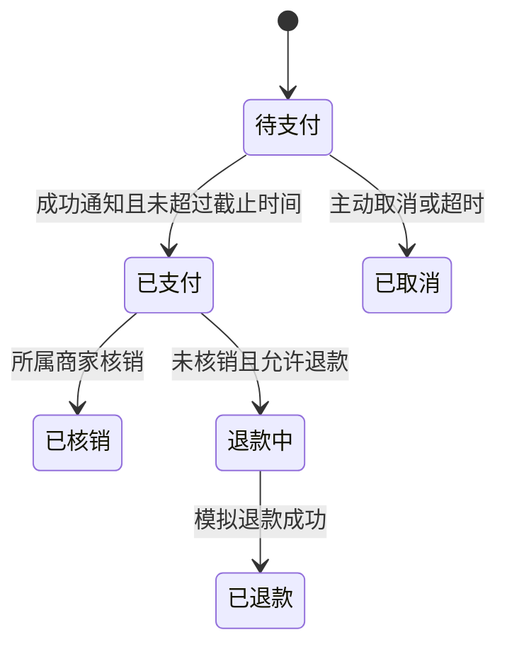
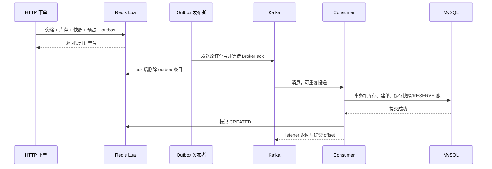

# 非 AI 功能代码阅读指南

更新：2026-11-25。本文对应当前源码。预约、AI 顾问与独立 `consultant/` 工程本轮不启用。支付和退款使用本地模拟渠道，不产生实际扣款。

## 建议阅读顺序

| 顺序 | 文件/方法（路径相对于项目根目录） | 重点理解 |
| --- | --- | --- |
| 1 | `src/main/java/com/hmdp/config/MvcConfig.java`、`utils/RefreshTokenInterceptor.java`、`utils/LoginInterceptor.java` | Redis Token 恢复登录用户，`UserHolder` 保存本次请求身份，请求结束清理线程变量 |
| 2 | `controller/VoucherOrderController.java`、`business/OrderStrategyFactory.java` | 策略工厂按普通券/秒杀券类型选择下单实现 |
| 3 | `service/impl/VoucherOrderServiceImpl.java` 的 `purchaseNormalVoucher` | 同一购买请求重试回原订单；换请求号可再买普通券 |
| 4 | 同文件的 `seckillVoucher`、`src/main/resources/seckill.lua` | Lua 原子校验、预扣库存、限购、冻结快照、写预占和 outbox |
| 5 | `messaging/SeckillOrderPublisher.java`、`consumer/SeckillVoucherConsumer.java`、`createVoucherOrder` | Redisson 协调投递；Kafka 异步落库；库存与订单事务；offset 与重试 |
| 6 | `business/CommerceService.java` | 支付通知、发券、关单、退款、核销如何争用订单行锁并原子推进状态 |
| 7 | `service/ReliableEventService.java`、`messaging/ReliableEventPublisher.java`、`src/main/resources/restore-seckill-stock.lua` | DB 释放账、持久事件、Kafka、Redis Lua 如何保证一次返库 |
| 8 | `utils/CacheClient.java`、`service/cache/VoucherListCacheService.java`、`business/CatalogService.java` | 逻辑过期、空值缓存、互斥锁、版本校验和静态/实时数据分离 |
| 9 | `business/SocialService.java`、`business/SigninService.java`、`business/ShopQueryService.java` | SET/ZSET、同时间游标、Bitmap 跨月连续签到、GEO、HyperLogLog |
| 10 | `src/test/java/com/hmdp/BusinessClosureIntegrationTest.java` | 用真实 HTTP、数据库、Redis 和 Kafka 断言理解故障恢复与并发场景 |

## 商品、订单、支付、持有券各是什么

`tb_voucher` 是可售商品。`tb_order_detail` 是下单时冻结的金额、店铺、类型、规则和支付截止时间；商品后来改价，不改变旧订单。秒杀在 Lua 受理时冻结快照，消费者使用该快照，避免排队期间改价影响已受理订单。

`tb_payment` 记录本地模拟支付单。`tb_user_voucher` 是支付成功后真正发给用户的一张券，包含自己的核销码和使用状态。`tb_refund`、`tb_redemption` 分别记录退款和核销流水。商品 ID、订单 ID、持有券 ID 各有职责，不能混用。

没有 `tb_order_detail` 的历史订单只读。生命周期扫描、支付与返库都不会为它们补造快照；本次开发库原有的 8 笔订单继续保留原状态。

## 交易状态及锁顺序



数据库订单状态依次是 `1` 待支付、`2` 已支付、`3` 已核销、`4` 已取消、`5` 退款中、`6` 已退款。持有券使用 `UNUSED/USED/REFUNDING/REFUNDED`；查询时可将超过有效期的未用券显示为 `EXPIRED`。

所有交易支路先取得秒杀库存行锁（普通券跳过），再取得订单行锁，最后处理支付/持有券/退款等行。统一顺序降低死锁风险；退款与核销争用同一订单锁，只有满足当前合法状态的一方能成功。

`processNotice` 中的条件 UPDATE 同时检查“待支付”和数据库截止时间，返回更新行数 `1` 才发券。成功支付、更新订单、插入持有券和完成通知在同一事务；发券 INSERT 失败便整体回滚。

支付通知先用独立事务落盘，再处理业务，所以处理失败仍有恢复依据。若订单先关单而成功通知晚到，支付流水记录成功，并创建 `LATE_PAYMENT` 退款；订单保持取消，不再发券，也不再次释放库存。支付渠道的结果与订单业务终态因此可能不同。

退款先保存意图，把券冻结为 `REFUNDING`，再推进模拟结果。成功后券失效、订单变已退款；故障留待恢复任务。通知/退款达到重试上限会阻塞，管理员修复原因后才能重投。

## 为什么需要 outbox、唯一账目和重试



Redis 与 Kafka/MySQL 不能共同参加本地数据库事务。Lua 把预扣与 outbox 一起写入，发送失败就留下原记录；恢复后继续投递原订单号。消费者凭订单 ID、预占归属和唯一约束去重。数据库事务失败时，库存回滚，监听器抛错，Kafka offset 不前进。

Lua 原子执行不等于运行错误会回滚已执行命令。`seckill.lua` 因此先核验相关键类型和快照，再进行写操作。

返库时，`(order_id, kind)` 唯一账目保证 `RELEASE` 只产生一次；释放账、数据库库存加一及持久事件同事务提交。Redis 恢复脚本将“加库存”和“保存已应用标记”原子完成。DB 提交后 Redis 出错，或 Redis 成功后事件提交出错，都可重投且不重复返库。秒杀取消/退款仍保留限购资格；普通券没有秒杀库存或一人一券约束。

## 缓存与数据权威

店铺详情使用逻辑过期：有旧值先返回，由有界线程池重建；冷缓存回源。不存在的数据短期缓存空值。锁值保存本次 owner，Lua 解锁先比较 owner，避免旧线程误删新持有者的锁。

读取 DB 前记下共享版本，回填时再次校验。商品写入与失效事件在同一事务，事件处理推进版本；旧读晚到不能重新填回已失效的数据。券列表 Caffeine 与 Redis key 含共享版本，每个实例读版本后选新 key，其他实例的本地缓存也会失效。

两级券缓存只存静态商品资料。响应复制 DTO 后另读 Redis 可售库存，避免 Caffeine 长期展示预扣之前的库存。购买资格、支付金额、核销资格始终由 Lua/DB 规则判定，不能使用展示缓存决定交易。

新秒杀商品先 `ready=0`；Redis 初始化库存严格等于 DB 才变 `ready=1`。准备失败保存补偿事件，不能带着错误库存出售。已准备的活动不会用 DB 当前库存覆盖 Redis 中合法在途预占。

## 内容互动、签到和统计

点赞/关注关系先写 MySQL，可靠事件重建 Redis ZSET/SET。关系 INSERT/DELETE 真正改变才更新点赞计数，防止重复请求累计。旧数据无法还原具体点赞人时保留历史汇总数。

Feed 的 score 是发布时间；游标包含“上一页最后的 score”和“该 score 已读条数”。同时间的整页结果必须累计 offset，换 score 后重算，才能分页读完同一时刻的多条笔记。冷索引重建保留最近 1000 条动态。

签到按 `Asia/Shanghai` 日期，以月为 key；日期 1 对应位偏移 0，重复签到设置同一位。BITFIELD 读取区间的最低位对应最后一天，右移计数连续的 1，本月全连续才回溯上月；回溯上限为 120 个月。

附近检索使用 Redis GEO；价格/评分在完整结果上排序后分页。HyperLogLog 统计店铺当天近似 UV，按天分 key，不能作为精确订单数使用。商家统计中的支付、退款与核销数量来自真实交易表。

## 运行、授权与验收

```powershell
Set-Location D:\Development\neighbor-life
.\tools\Invoke-NeighborLife.ps1 -Action Run
# 另一个终端停止
.\tools\Invoke-NeighborLife.ps1 -Action Stop
# 只读检查结构
.\tools\Invoke-BusinessMigration.ps1 -Action Inspect
```

商家/管理员角色不会从手机号自动推断。先用目标账号登录注册，再按实际需要运行现有维护工具（先设置 `$registeredPhone` 为真实已注册手机号、`$ownedShopId` 为需要授权的店铺 ID）：

```powershell
.\tools\Invoke-BusinessMigration.ps1 -Action GrantMerchant -Phone $registeredPhone -ShopId $ownedShopId
.\tools\Invoke-BusinessMigration.ps1 -Action GrantAdmin -Phone $registeredPhone
```

独立验收命令为 `.\tools\Invoke-BusinessVerification.ps1`，要求专用 `neighborlife-loadtest` 容器和 `3307/6380/9093` 端口，脚本还校验容器身份、数据库 URL 与 marker。测试输出在 `target/business-verification/`，避免与 IDE 增量编译互相覆盖。不要用开发库运行包含大量写入的旧测试，也不要向已有库导入带 DROP 的初始化 SQL。

最终证据和当前边界见 `docs/development/非AI功能实现与开发环境启用验收-20261125.md`。普通启动支持 `default` 配置、JDK 11；没有单独的 development profile。
