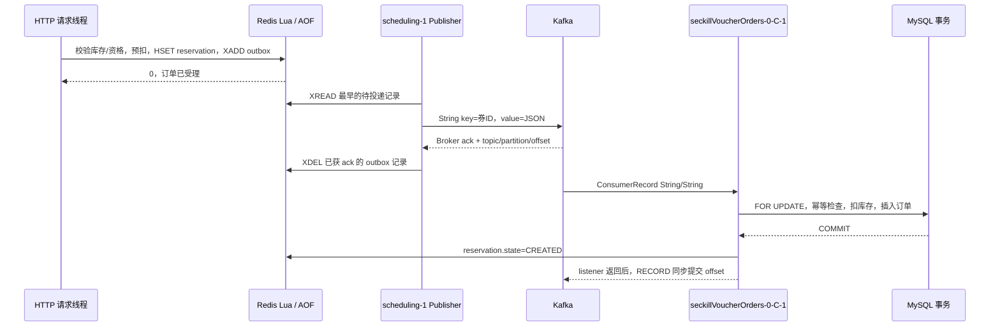

# NeighborLife 阶段三联调与秒杀验收

日期：2026-11-24，Asia/Shanghai。工作目录：`D:\Development\neighbor-life`。依据实际源码、真实 HTTP、MySQL、Redis、Kafka 和应用日志。

**后端完整秒杀链路 PASS；阶段三整体验收尚未完成。Chrome Network 与本轮 VS Code 异步断点未验证，均为 UNKNOWN。收藏没有后端持久化接口。未提交、未 Push，未运行 JMeter、支付网关或 consultant。**

后续增量（同日）：普通券已增加真实购买按钮、事务订单接口和重试幂等；内置浏览器实测普通订单及秒杀后库存刷新，见[普通优惠券购买验证](普通优惠券购买验证.md)。原 Chrome Network 与 Consumer 异步断点 UNKNOWN 状态保留。

## 1. 初始问题与最小修复

保留阶段一、阶段二及用户已有的暂存、未暂存、未跟踪文件。修改前备份位于 `target/phase3-baseline/`，包含目标文件及 SHA256；未更改暂存区。

| 当前代码原问题 | 处理 |
| --- | --- |
| `SeckillVoucherConsumer` 的 `@KafkaListener` 被注释 | 注册真实监听器，固定 listener id 为 `seckillVoucherOrders` |
| Producer 发送 `VoucherOrder.toString()`，Consumer 强转对象 | 两端使用 Kafka StringSerializer/StringDeserializer，载荷为 JSON，订单三个 ID 使用十进制字符串 |
| 配置曾导入 Jackson 的反序列化类；自定义工厂被注释 | 用实际 `KafkaProperties` 构建 Kafka ConsumerFactory |
| spring-kafka 2.9.13 / kafka-clients 2.6.0 与 Boot 管理版本混用 | 使用 Boot 2.3.12 管理的 spring-kafka 2.5.14.RELEASE / kafka-clients 2.5.1；实际启动和消费通过 |
| RECORD 模式与手动 Acknowledgment 混用 | 统一 RECORD、关闭自动提交、同步提交 offset |
| Consumer 锁获取失败、数据库库存不足时直接返回，可能被当作成功 | 失败抛出异常；保留记录重试，不静默返回成功 |
| 库存扣减与订单插入没有事务 | 经 Spring 代理调用 `@Transactional` 方法，两个 MySQL 写入同时提交/回滚 |
| 没有订单 ID、用户/券幂等保护 | InnoDB 券行锁、订单 ID 检查、用户/券检查、唯一索引 |
| Redis 扣减与 Kafka 发送之间存在丢单窗口，Future 未检查 | Lua 同时写入 Redis 待投递 Stream；Publisher 等待 Kafka ack 后才删除 Stream 记录，异常保留重试 |
| 库存 key 不存在时 Lua 对 nil 做比较；未检查 key 类型 | 返回 3 表示未初始化，4 表示类型/数据错误；先检查类型再写入 |
| API 原先没有检查券状态、类型、秒杀时间 | 读取真实券信息并检查上架状态、类型、开始和结束时间 |
| 新增秒杀券没有初始化 Redis 库存 | MySQL 新券事务提交后执行 SETNX 初始化，避免覆盖已有预扣库存 |
| Redis AOF 默认 everysec；订单 Topic 默认有保留期 | 本地 Compose 设置 AOF/appendfsync=always；订单 Topic retention.ms/bytes=-1，避免未处理记录到期删除 |
| JS 用 Number 接收大于 2^53 的订单 ID | API 返回字符串，消息和页面保留完整 ID |
| 前端点赞在请求后自行推算状态 | PUT 后复用 GET `/blog/{id}`，显示后端读回的计数和 isLike |
| 不存在的笔记也可能返回点赞成功 | 数据库未更新时返回失败 |
| 收藏只有 localStorage；后端退出未实现 | 明确保留功能边界，不增加伪成功接口 |

## 2. 前后端功能对应表

`api()` 会携带 sessionStorage 中的 token，并在 12 秒后取消请求。HTTP 接口已实测；下表的 Chrome Network 列均为 UNKNOWN，因为本轮浏览器控制被安全校验中止：无法确认当时活动 URL 是否允许访问。没有使用其他方式绕过该界面限制。

| 前端操作 | JS 函数/事件 | HTTP 请求 | Controller → Service | Mapper / Redis | 最终数据、验证 |
| --- | --- | --- | --- | --- | --- |
| 获取验证码 | `#send-code` click → `api` | POST `/user/code?phone=…` | UserController.sendCode → UserServiceImpl.sendCode | Redis `login:code:{phone}`，TTL 2 分钟 | 独立测试手机号的真实随机验证码；仅写 Redis 和日志，未接短信服务；HTTP PASS / Network UNKNOWN |
| 登录 | `#login-form` submit | POST `/user/login` | UserController.login → UserServiceImpl.login | UserMapper 查询/新增 tb_user；Redis `login:token:{token}` Hash + TTL | MySQL 用户真实存在、Redis token 身份读回；PASS / Network UNKNOWN |
| 当前身份、恢复会话 | 登录事件、启动时 `api` | GET `/user/me` | UserController.me；RefreshTokenInterceptor → UserHolder | Redis token Hash → 请求线程 ThreadLocal | 返回自己的 UserDTO；匿名 HTTP 401；PASS / Network UNKNOWN |
| 退出此浏览器 | `#clear-session` → `clearAuth` | 无 | 后端 POST `/user/logout` 返回“功能未完成”，前端未调用 | 只移除 sessionStorage token | Redis token 尚未撤销；后端退出缺失，不认定服务端登出成功 |
| 店铺列表、分页 | `loadShops` | GET `/shop/of/name?current=…` | ShopController.queryShopByName → MyBatis-Plus service query | ShopMapper → tb_shop | 真实分页数据；PASS / Network UNKNOWN |
| 分类 | `renderCategories` click → `loadShops` | GET `/shop-type/list`；GET `/shop/of/type?typeId=…&current=…` | ShopTypeController / ShopController → ShopTypeServiceImpl / ShopServiceImpl.queryShopByType | ShopTypeMapper / ShopMapper；有坐标时使用 Redis GEO | 无坐标分类查询实测 PASS；GEO 分支本轮未实测；Network UNKNOWN |
| 名称搜索 | `#search-form` submit → `loadShops` | GET `/shop/of/name?name=…&current=…` | ShopController.queryShopByName | tb_shop LIKE 查询 | 独立测试名称返回 1 条，真实店铺 103 详情可读；PASS / Network UNKNOWN |
| 店铺详情 | `showShop` | GET `/shop/{id}` | ShopController.queryShopById → ShopServiceImpl.queryById → CacheClient.queryWithPassThrough | Redis `cache:shop:{id}`；缺失时 ShopMapper 查询 MySQL | `id=1,name=103茶餐厅`；PASS / Network UNKNOWN |
| 探店笔记列表 | `loadNotes` | GET `/blog/hot?current=…` | BlogController.queryHotBlog → BlogServiceImpl.queryHotBlog | BlogMapper、UserMapper；Redis `blog:liked:{blogId}` | MySQL 笔记、作者、计数、登录者点赞状态；PASS / Network UNKNOWN |
| 打开笔记 | `showNote` | 当前不额外发请求 | 使用 `loadNotes` 的真实后端数据在页面展开；已有 GET `/blog/{id}` 可复用 | 当前页/侧栏 JS 数据 | 不是写入操作；不将页面展开认定为新后端详情请求 |
| 点赞/取消点赞 | `likeNote` | PUT `/blog/like/{id}`，然后 GET `/blog/{id}` | BlogController.likeBlog / queryBlogById → BlogServiceImpl | tb_blog.liked +/-1；Redis ZSET `blog:liked:{id}` 加/删用户 | MySQL 0→1→0、Redis absent→present→absent，后端 isLike 读回；PASS / Network UNKNOWN |
| 收藏/取消收藏、收藏页 | `toggleSaved`、`loadSaved`、`setView('saved')` | **无** | **没有店铺收藏后端接口**；FollowController 是关注用户接口，不能代替收藏店铺 | localStorage `neighborlife.saved` | 只保存在当前浏览器；MySQL/Redis 收藏持久化缺失，UNKNOWN |
| 优惠券列表 | `showShop` 并行请求 → `voucherElement` | GET `/voucher/list/{shopId}` | VoucherController.queryVoucherOfShop → VoucherServiceImpl → VoucherListCacheService | VoucherMapper SQL；配置为 mysql，实际查询 tb_voucher/tb_seckill_voucher | 当前返回上架普通券与秒杀券；HTTP/内置浏览器 PASS / Chrome Network UNKNOWN |
| 普通券购买 | `submitNormalVoucher → submitVoucherOrder` | POST `/voucher-order/normal/{id}` | VoucherOrderController.purchaseNormalVoucher → VoucherOrderServiceImpl.purchaseNormalVoucher | VoucherMapper 券行锁；VoucherOrderMapper MySQL 插单，事务提交后响应 | 真实待支付订单、重试幂等；HTTP/内置浏览器 PASS / Chrome Network UNKNOWN |
| 秒杀提交 | `submitSeckill` | POST `/voucher-order/seckill/{id}` | VoucherOrderController → VoucherOrderServiceImpl.seckillVoucher | Lua 预扣、资格 SET、reservation Hash、outbox Stream | 返回已受理的字符串订单 ID，尚不代表 MySQL 完成或支付成功；后端 PASS / 页面 UNKNOWN |
| 查询创建状态 | `submitVoucherOrder` 中轮询 | GET `/voucher-order/{id}` | VoucherOrderController.queryOrderStatus → VoucherOrderServiceImpl.queryOrderStatus | MySQL 自己的订单；秒杀未落库时读取自己的 reservation | PENDING / CREATED，订单状态 1=待支付；匿名 401、其他用户无权查看；后端/内置浏览器 PASS / Chrome Network UNKNOWN |

页面中的评分/价格排序只排序当前页 JS 数据，不是全库排序接口；笔记编辑、发布、支付和订单管理页面没有在本轮扩展。

## 3. 登录、点赞、收藏持久化

- 登录：通过真实验证码接口、Redis 读出仅供测试的验证码、真实登录接口完成注册/登录。查询 tb_user、token Hash 中的 id 和 TTL，再 GET `/user/me` 核验。未读取或使用真实用户凭据。
- 点赞：独立测试笔记初始 liked=0，PUT 后 MySQL=1 且 Redis 有该用户；GET 详情 isLike=true；再次 PUT 后 MySQL=0 且 Redis 成员消失。前端没有以本地计数变化代替后端成功。
- 收藏：源码没有 HTTP 请求或收藏 Mapper/表/Redis key。已存在的浏览器本地收藏展示仍保留。`FAVORITE_PERSISTENCE_PASS=UNKNOWN` 的原因是后端功能缺失，不是已通过。
- 剩余边界：点赞仍沿用已有 MySQL + Redis 两步写入，未实现跨系统事务；并发切换或 Redis 写失败的严格一致性没有通过本轮故障测试。后端登出未实现。本次不声称这些能力已具备。

## 4. 秒杀链路与一致性边界



### Lua 实际数据

Java 传入四个 KEYS：`seckill:stock:{voucherId}`、`seckill:order:{voucherId}`、outbox Stream（默认 `seckill:outbox`）、`seckill:reservation:{orderId}`。ARGV 是券 ID、用户 ID、订单 ID。

返回码：0=预扣并记录成功；1=售罄；2=已下单；3=库存未初始化；4=类型/数据不符合约定。资格检查在售罄检查之前，已购买者仍返回“重复下单”。成功时原子执行 INCRBY -1、SADD、HSET、XADD。独立测试覆盖 0/1/2/3/4。

Redis Lua 对并发客户端原子执行，但运行时错误不会自动撤销之前的命令，因此脚本先检查所有 key 类型和库存整数。实现针对当前单机 Redis，未声称支持 Redis Cluster 跨槽执行。

### ID 与消息

RedisIdWorker 使用真实 UTC 秒数减去 2022-01-01 起始时间戳，左移 32 位，再拼接 Redis 当日计数 `icr:order:yyyy:MM:dd`。加入计数范围检查。没有回退/重置共用 ID 序列，测试造成的合法序列间隙保留。

Publisher 从 Stream 读取字符串字段，JSON 形如 `{"id":"663554021822300172","userId":"1017","voucherId":"15"}`；不是 Java toString，也没有任意类型反序列化。Topic 默认 `seckill-voucher-order`；实际 1 分区，key=券 ID。默认 group 保留为 `your-group-id`，没有重置原 group。acks=all、enable.idempotence=true；Broker 副本数为当前本地环境的 1。

### 投递、失败与幂等

- HTTP 成功的依据是 Redis 已持久记录预扣和待投递订单。Publisher 等到真实 Kafka ack 后删除 outbox；发送异常/超时保留记录。进程在 ack 与 XDEL 之间退出，会重发同一订单 ID，由数据库幂等处理。
- 不在 Kafka 发送超时时直接“加回库存”：发送结果可能不确定，消息可能已到 Broker。保留原 ID 重试避免错误补偿后再被消费。
- MySQL 方法先锁定券行，再检查订单 ID、用户/券，随后扣减并插入。重复 ID 对应相同用户/券则直接返回；碰撞、缺 reservation、同用户不同订单或库存不一致均抛异常，不推进 offset。
- 唯一索引 `uk_voucher_order_user_voucher(user_id,voucher_id)` 已添加，添加前查重为 0；没有删除原订单以迁就索引。迁移 SQL 保存在 `src/main/resources/db/migration/phase3-order-idempotency.sql`。
- 消费失败采用无限间隔重试，异常及 offset 写入日志，不采用“只记录一下然后跳过”的 recoverer。类型解析失败、永久业务错误会阻塞所在分区，需运维修复。没有实现外部告警发送或自动死信处理。
- 数据库事务代理返回后才更新 Redis CREATED；更新 Redis 失败会重试，同一 MySQL 订单不会再次扣库存。只有整个 listener 成功返回后才确认 offset。
- Topic retention.ms=-1、retention.bytes=-1，防止长时间未处理订单按默认保留期消失。已消费数据需另行安全归档/清理，不能无限增长而无人维护。

### 可恢复条件与补偿方案

这是最终一致性实现，不是 Redis/Kafka/MySQL 分布式事务。保证范围是：初始库存一致、AOF/Kafka 日志可恢复、基础设施在数据保留期间恢复、数据库能够提交有效订单。当前本地 Redis AOF/appendfsync=always 已实查；Kafka/MySQL/Redis 都是单节点持久卷，没有验证磁盘永久损坏或生产高可用。

如果 Redis 持久数据丢失、库存被外部错误修改或订单永久违反业务约束，自动重试不能自行创造正确状态。应先冻结对应券的新请求，按订单 ID 对照 MySQL、reservation、outbox、Kafka partition/offset；优先重放尚未完成的原订单。只有确认无在途投递、offset 已提交，才根据 MySQL 剩余库存和已有购买用户恢复该券的 Redis 库存/资格。不能仅凭一次 Kafka 超时删资格并加库存，也不能直接清空 Redis。这种生产修复流程没有自动实现，本轮仅实现并验证了独立测试数据的安全 Reset/Cleanup。

## 5. 独立数据与真实结果

自动测试使用运行 ID 独立的 Topic、Group、outbox；真实 MySQL/Redis，真实 HTTP，3 个新测试用户、新店铺、新笔记、新秒杀券。手工调试工具另创建自己的用户、店铺、笔记及 3 张库存为 3 的券。均不使用真实支付，不修改原用户/店铺/券的业务字段。

| 测试场景 | Redis 库存 | MySQL 库存 | 订单数 | 结论 |
| --- | ---: | ---: | ---: | --- |
| 正常券初始 | 2 | 2 | 0 | 初始一致 |
| 第一单完成 | 1 | 1 | 1 | Lua → Kafka → MySQL 完成 |
| 同用户重复请求 | 1 | 1 | 1 | 返回重复下单 |
| 同订单 Kafka 重复消息 | 1 | 1 | 1 | offset 推进，库存/订单数未再次变化 |
| 第二用户成功，第三用户售罄 | 0 | 0 | 2 | 无超卖 |
| MySQL INSERT 触发器制造失败 | 1 | 2 | 0 | DB 扣减回滚，Kafka offset 未确认，预扣仍待处理 |
| 移除仅针对测试券的触发器后重试 | 1 | 1 | 1 | 自动恢复一致 |
| Consumer 停止，消息已投递 | 1 | 2 | 0 | 消息保留待消费 |
| Consumer 重新启动 | 1 | 1 | 1 | 恢复消费 |
| 3 用户同时竞争 2 份库存 | 0 | 0 | 2 | 2 成功、1 售罄 |
| Publisher 使用真实不可达端口的 Producer | 1 | 2 | 0 | outbox 保留，未伪造发送成功 |
| 恢复真实 Broker Producer 后投递 | 1 | 1 | 1 | 同一 reservation 完成 |
| 默认 Topic 的独立券初始/完成/Reset | 3→2→3 | 3→2→3 | 0→1→0 | 实际 group/topic 验证及库存复位 |

故障 Producer 指向不可达的本机端口，原 Broker 保持运行；使用真实 Kafka 异常，不是固定成功响应。Consumer 恢复测试是 listener 容器 stop/start，没有冒充整个 Windows 或数据库重启测试。

自动测试清理后：tb_shop=14、tb_user=5、tb_blog=4、tb_voucher=1、tb_seckill_voucher=0、tb_voucher_order=0，与本轮测试前一致。阶段一记录的用户数 4 是当时历史状态，本轮实际初始值是 5，原有这 5 个用户均保留。默认链路测试清理还逐表比较原数据 SHA256，完全一致。没有清空 Redis，没有 DROP/重建业务表；只增加了必要唯一索引。测试用户/券的自增编号间隙不强行回退。

Reset/Cleanup 先确认 Kafka offset 已提交、没有该测试券的 outbox 消息、MySQL/Redis 库存一致且库存+订单数=初始 3，再操作自有数据。本轮默认 Topic 原本没有业务记录，清理前读回整个候选前缀，证明唯一消息属于该 fixture，才删除该测试前缀；发现任何非自有记录则保留 Topic 原记录。

## 6. 修改文件及原因

| 文件 | 原因 |
| --- | --- |
| pom.xml | 使用 Boot 管理的兼容 Kafka 版本 |
| application.yaml、KafkaConfig.java | 消息序列化、监听器工厂、ack、重试、Topic 保留策略 |
| HmDianPingApplication.java | 启用定时 outbox 投递 |
| SeckillConstants.java、messaging/SeckillOrderPublisher.java | 持久待投递记录及真实 Kafka ack/异常处理 |
| seckill.lua | 预扣、资格、reservation、outbox 原子记录及类型保护 |
| VoucherOrderServiceImpl.java、IVoucherOrderService.java | 有效券检查、事务、幂等、字符串 ID、订单状态查询 |
| SeckillVoucherMapper.java、phase3-order-idempotency.sql | InnoDB 行锁、唯一约束 |
| SeckillVoucherConsumer.java | 注册消费、解析 JSON、事务提交后完成状态、成功返回后确认 |
| VoucherOrderController.java | 复用秒杀入口，新增自己的订单状态查询 |
| VoucherServiceImpl.java | 新券提交后初始化 Redis 库存 |
| RedisIdWorker.java | UTC 时间编码和序列范围保护 |
| BlogServiceImpl.java | 不存在/未更新笔记不返回点赞成功 |
| static/assets/app.js | 点赞后端读回、提交秒杀订单与查询真实落库状态、保留完整订单 ID |
| docker/compose.yaml、tools/Invoke-LocalDependencies.ps1 | AOF always 及现有订单 Topic 的保留配置 |
| Phase3IntegrationTest.java | 真实独立数据、库存/订单/offset、故障与幂等验证 |
| tools/Phase3Fixture.java、Invoke-Phase3Verification.ps1 | 可重复测试和人工调试数据的 Prepare/Inspect/Submit/Reset/Cleanup |
| 阶段三报告、断点教程、manual 文档 | 记录验证范围、业务边界和可操作的步骤 |

## 7. 重复执行与 VS Code 调试

自动验证（仅选择阶段三测试，不运行历史批量测试）：

```powershell
Set-Location D:\Development\neighbor-life
.\tools\Invoke-LocalDependencies.ps1 -Action Start
.\tools\Invoke-Phase3Verification.ps1 -Action Test
```

人工调试使用已有 F5 配置启动后，再执行 Prepare/Inspect/Submit/Reset/Cleanup。详细方法、变量、线程和精确行号见 [阶段三秒杀断点调试.md](阶段三秒杀断点调试.md)。本轮没有实际执行这些 VS Code 异步断点，因此不将教程编写记为 IDE_DEBUG_PASS。

## 8. 证据

- `docs/development/evidence/phase3/integration-tests.json`：最终自动测试库存、订单、offset 和通过项。
- `target/phase3-integration-test.log`：真实 SQL、Publisher、Consumer 及有意制造的故障/重试；该日志中的测试故障不代表最终失败。
- `default-before.txt`、`default-submit.txt`、`default-after.txt`、`default-chain-log.txt`：默认 Topic/Group 的请求、发送、消费、库存结果。
- `default-reset.txt`、`default-cleanup.txt`、`default-fixture-cleanup.json`：复位、原数据 SHA256 保留证明。
- `target/phase3-dependency-final.log`：中间件及保留配置检查。
- `final-state.json`：清理后业务表行数、唯一索引、零测试触发器、空 outbox、默认 Topic/Group 和实际 AOF/保留配置；独立测试 Topic 已清理。
- `acceptance.json`：本轮 11 项验收状态及 UNKNOWN 原因。
- 原始测试日志的可长期保存摘要位于 `docs/development/evidence/phase3/`；target 会在 Maven clean 后删除。测试 token 仅放临时私有 fixture 文件，已在 Cleanup 删除，没有写入验收报告或提交文件。

## 9. 验收状态

| 状态 | 结果 | 依据/缺口 |
| --- | --- | --- |
| FRONTEND_BACKEND_INTEGRATION_PASS | UNKNOWN | 真实 HTTP 和源码映射已完成，Chrome 页面操作/Network 未完成 |
| LOGIN_PASS | PASS | 真实注册/登录、MySQL 用户、Redis 身份和 HTTP 鉴权 |
| SHOP_QUERY_PASS | PASS | 真实列表、详情、分类、搜索 |
| LIKE_PERSISTENCE_PASS | PASS | 独立笔记 MySQL 和 Redis 加/删及后端读回 |
| FAVORITE_PERSISTENCE_PASS | UNKNOWN | 仅 localStorage，没有后端收藏接口 |
| LUA_SECKILL_PASS | PASS | 0/1/2/3/4、预扣记录、并发库存 |
| KAFKA_PRODUCER_PASS | PASS | 默认 Topic 及独立 Topic 实际发送；失败保留后恢复 |
| KAFKA_CONSUMER_PASS | PASS | 注册、真实消费、失败重试、停止恢复、offset 提交关系 |
| MYSQL_ORDER_PASS | PASS | 真实待支付订单、唯一约束、事务回滚、幂等 |
| IDE_DEBUG_PASS | UNKNOWN | 本轮 Consumer 异步断点未操作；阶段二 HTTP 断点通过不能替代它 |
| CORE_CHAIN_PASS | PASS | 完整秒杀后端链路及库存最终一致性通过上述可恢复故障测试 |

继续停留在阶段三，补齐 Chrome Network 和 VS Code Consumer 异步断点证据；没有启动下一阶段。

本轮验证后端已停止，8081 已释放，三个中间件仍健康运行；重新按 F5 后可使用独立数据工具继续验收。
